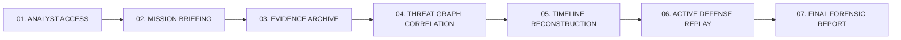

# TRACE//ZERO — THE MIDNIGHT BREACH
### Interactive Digital Forensics & Incident Response (DFIR) Simulator
**Pixel Wars X26 Hackathon Submission · Case #TR-2049 · NEXORA TECHNOLOGIES**

```text
  ████████╗██████╗  █████╗  ██████╗███████╗██████╗ ███████╗██████╗  ██████╗ 
  ╚══██╔══╝██╔══██╗██╔══██╗██╔════╝██╔════╝╚════██╗██╔════╝██╔══██╗██╔═══██╗
     ██║   ██████╔╝███████║██║     █████╗   █████╔╝█████╗  ██████╔╝██║   ██║
     ██║   ██╔══██╗██╔══██╗██║     ██╔══╝  ██╔═══╝ ██╔══╝  ██╔══██╗██║   ██║
     ██║   ██║  ██║██║  ██║╚██████╗███████╗███████╗███████╗██║  ██║╚██████╔╝
     ╚═╝   ╚═╝  ╚═╝╚═╝  ╚═╝ ╚═════╝╚══════╝╚══════╝╚══════╝╚═╝  ╚═╝ ╚═════╝ 
                      [ CASE #TR-2049 // THE MIDNIGHT BREACH ]
                        "EVERY BREACH LEAVES A TRACE."
```

[](https://react.dev/)
[](https://tailwindcss.com/)
[](https://motion.dev/)
[](https://vitejs.dev/)
[](https://attack.mitre.org/)

---

## ⚡ Executive Briefing & Incident Dossier

At **02:14:03 UTC**, network sensors within **NEXORA Technologies'** classified research enclave flagged abnormal outbound telemetry. A senior staff account belonging to lead researcher `s.mercer` was observed executing suspicious lateral traversals into the proprietary **Project Helios cipher vault**. 

Within **59 seconds**, **1.46 GB** of encrypted architecture schematics and cryptographic keymaps were staged and exfiltrated to an external bulletproof endpoint (`185.220.101.5`). In an attempt to obstruct timeline attribution, the adversary executed anti-forensic commands to purge 318 audit log records before terminating the SSH session.

**Your Objective:** As the Lead Digital Forensics Analyst, you must enter Case `#TR-2049`, analyze compromised forensic artifacts, extract indicators of compromise (IOCs), map causal correlations across the threat graph, reconstruct the chronological breach sequence, and deploy strategic defensive controls to neutralize future exposure.

---

## 🎮 The Investigation Flow



### 1. Analyst Access & Session Security (`/login`)
- **Cyberpunk Terminal Aesthetic:** Full-screen viewport featuring animated matrix-rain canvas, scanline overlays, and a blinking boot sequence (`> INITIALIZING SECURE CHANNEL... OK`).
- **Cryptographic Security:** Client-side SHA-256 hashing via native Web Crypto API (`crypto.subtle.digest`) with individual salt.
- **Per-User Progress Scoping:** Multi-user isolation allowing distinct analysts to investigate, record notes, and compete on the same physical device without overwriting state.
- **Demo Mode:** Instant one-click guest access or pre-seeded credential login.

### 2. Evidence Archive & Forensic Lab (`/lab`)
- **Interactive Multi-Source Triage:** Six authentic forensic items spanning phishing lures, volatile memory dumps, system auth logs, database queries, network packet captures, and deleted file fragments.
- **Deep Email Header RFC Validation:** Real-time analysis of `SPF`, `DKIM`, and `DMARC` authentication failures, forged sender domains, and quarantined `.pdf.exe` double-extension payloads.
- **Sysmon & Event Log Inspector:** Searchable, filterable audit tables with severity chips (`CRITICAL`, `HIGH`, `ALERT`, `SUSPICIOUS`, `NORMAL`) and process-level memory scraping breakdowns.
- **Forensic Clue Extraction:** Pinpoint critical evidence IOCs to build evidentiary confidence.
- **Dynamic Hints Protocol:** On-demand forensic advisories with visible score penalty balancing.

### 3. Threat Graph & Evidence Correlation (`/correlate`)
- **Interactive SVG Threat Canvas:** Visual correlation matrix with live reticle nodes, traveling packet pulse animations along data links, and midpoint relationship badges.
- **Four Forensic Link Types:** Categorize connections as *Causal*, *Chronological*, *Corroborative*, or *Contradictory*.
- **Instant Validation Feedback:** Live evaluation engine providing immediate visual reinforcement (green glow for confirmed forensic links, subtle red pulse for invalid theories).
- **Hypothesis Dossier:** Synthesize findings into an official investigative theory.

### 4. Incident Reconstruction Gameplay (`/reconstruct`)
- **Drag-and-Drop Chronology:** Order reconstructed incident events across the temporal timeline from initial intrusion to log purging.
- **MITRE ATT&CK® Learning Matrix:** Expandable educational cards mapping attacks to real-world techniques (`T1566.001` Spearphishing, `T1003.001` OS Credential Dumping, `T1021.004` Remote Services SSH, `T1041` Exfiltration Over C2, `T1070.001` Indicator Removal).
- **Automated Algorithmic Scoring:** Real-time scoring factoring absolute slot accuracy, relative pairwise sequence order, and drift penalties.

### 5. Active Defense Replay (`/replay`)
- **Security Budget Allocation:** Operate within a 100-point defense budget to deploy 6 enterprise countermeasures:
  - *FIDO2 Hardware MFA* (30 pts)
  - *Least Privilege & Just-In-Time Access* (25 pts)
  - *Micro-segmentation & Jump Bastion* (25 pts)
  - *EDR with LSA Memory Protection* (30 pts)
  - *Inline Network DLP & Egress Filter* (35 pts)
  - *WORM Immutable Remote Logging* (20 pts)
- **Live Attack Pipeline Simulation:** Animate the adversary traversing all 7 attack stages. Observe whether deployed defenses successfully intercept, sever, or contain the threat.
- **Side-by-Side Comparison:** Direct visual comparison of *"Without Defense"* (7/7 breached, 1.46 GB lost, $2.4M impact) vs *"With Active Defense"* (contained at Stage 2, 0 bytes exfiltrated).
- **Case Reset:** Clear session state to test alternative defensive configurations.

### 6. Final Forensic Audit Report (`/report`)
- **Comprehensive Incident Report:** Seven-section formal DFIR post-mortem detailing executive metrics, forensic findings, timeline accuracy, defense efficacy, and MITRE remediation advice.
- **Analyst Attestation & Digital Badge:** Personal callsign, badge ID, tier rank, and timestamp.
- **Light Print Theme via `@media print`:** Dedicated print stylesheet stripping dark backgrounds for clean, high-contrast, black-and-white executive PDF printing with zero page-break clipping.

---

## 🏆 Gamification & Analyst Progression

TRACE//ZERO features an integrated progression and evaluation system that rewards forensic precision:

| Tier | Rank Title | Required XP | Badge Style | Profile Archetype |
|:---:|:---|:---:|:---:|:---|
| **LVL 1** | **ROOKIE ANALYST** | 0 – 249 XP | `#9CA3AF` | Junior forensic operative; learning log triage |
| **LVL 2** | **FORENSIC ANALYST** | 250 – 549 XP | `#22D3EE` | Skilled investigator; adept at packet & memory analysis |
| **LVL 3** | **SENIOR INVESTIGATOR** | 550 – 849 XP | `#F59E0B` | Incident lead; expert correlation & attack reconstruction |
| **LVL 4** | **ELITE HUNTER** | 850+ XP | `#B7FF3C` | Master threat hunter; flawless attack chain interception |

### XP Allocation Mechanics
- **Artifact Investigation:** `+25 XP` per analyzed evidence file (up to `150 XP`)
- **Clue Extraction:** `+15 XP` per identified forensic clue (up to `180 XP`)
- **Threat Graph Correlation:** `+45 XP` per validated causal link (up to `225 XP`)
- **Timeline Accuracy:** Up to `+220 XP` scaled to chronological precision
- **Defense Interception:** Up to `+240 XP` based on stages neutralized and budget efficiency
- **Hint Penalties:** `-15 XP` to `-20 XP` per hint to encourage independent deduction

### Competitive Leaderboard
Integrated local leaderboard tracking completion records, total XP, rank titles, and audit timestamps.

---

## 🛠️ Technology Stack & Architecture

```text
 c:\TRACE-ZERO\
 ├── src/
 │   ├── components/            # Reusable UI & forensic widgets
 │   │   ├── correlation/       # Graph canvas, link inspector, clue drawer
 │   │   ├── lab/               # Email viewer, Sysmon viewer, PCAP viewer
 │   │   ├── replay/            # Attack topology map, budget bar, control cards
 │   │   ├── Hero.jsx           # Cinematic intro & radar visualization
 │   │   ├── Navbar.jsx         # Technical HUD header with rank badge & logout
 │   │   ├── HowItWorks.jsx     # 3-step investigation methodology timeline
 │   │   ├── ProgressStepper.jsx# Persistent navigation breadcrumb stepper
 │   │   ├── MitreAttackCard.jsx# Interactive MITRE ATT&CK learning matrix
 │   │   ├── OnboardingModal.jsx# Guided investigator tutorial walkthrough
 │   │   └── LeaderboardModal.jsx# Top investigative operatives leaderboard
 │   ├── contexts/
 │   │   └── AuthContext.jsx    # Authentication & reactive user state provider
 │   ├── data/
 │   │   ├── evidenceData.js    # 6 evidence files, clues, and metadata
 │   │   ├── correlationData.js # Evaluation matrix for all possible node pairs
 │   │   ├── reconstructionData.js# Canonical events, shuffled generators, evaluation
 │   │   └── defenseData.js     # 6 defensive controls, 7 attack stages, simulation engine
 │   ├── pages/
 │   │   ├── LoginPage.jsx      # Analyst Access screen with matrix rain
 │   │   ├── LandingPage.jsx    # Narrative case landing page
 │   │   ├── InvestigationBriefing.jsx # Tactical directive and suspect file
 │   │   ├── EvidenceLab.jsx    # Evidence examination workspace
 │   │   ├── EvidenceCorrelation.jsx # Threat graph correlation screen
 │   │   ├── IncidentReconstruction.jsx # Timeline reconstruction screen
 │   │   ├── DefenseReplay.jsx  # Defensive controls simulation workspace
 │   │   └── ForensicReport.jsx # Printable executive audit dossier
 │   ├── services/
 │   │   ├── authService.js     # Web Crypto SHA-256 auth & demo credentials
 │   │   ├── progressService.js # Per-user scoped localStorage persistence
 │   │   └── rankService.js     # XP calculations, ranks, and leaderboard
 │   ├── App.jsx                # Route protection and root orchestration
 │   ├── index.css              # Cyber theme tokens, scanlines, and print stylesheet
 │   └── main.jsx               # Application entry point
 ├── index.html                 # HTML shell with Google Fonts (Inter + JetBrains Mono)
 ├── package.json               # Dependencies and scripts
 └── vite.config.js             # Vite 8 + React plugin configuration
```

- **Frontend Core:** React 19 + JavaScript JSX
- **Styling & Design Tokens:** Tailwind CSS v4 (using `@theme` custom properties)
- **Motion & Micro-interactions:** Motion v14 (`motion/react`)
- **Icons:** Lucide React
- **Cryptography:** Native browser Web Crypto API (`SubtleCrypto`)
- **Typography:** JetBrains Mono (technical monospace) + Inter (headings and body)

---

## 🚀 Quickstart & Local Installation

### Prerequisites
- Node.js (v18.0 or higher)
- npm or pnpm

### 1. Clone & Install Dependencies
```bash
git clone https://github.com/your-username/trace-zero.git
cd trace-zero
npm install
```

### 2. Start the Development Server
```bash
npm run dev
```
Open your browser and navigate to `http://localhost:5173`.

### 3. Build for Production
```bash
npm run build
```
Creates an optimized, production-ready bundle in the `dist/` directory.

---

## 🔑 Demo Access Credentials

The simulator comes pre-seeded with analyst credentials, or you can register a custom callsign or use guest mode:

| Access Mode | Username / Email | Password | Role / Callsign |
|:---|:---|:---|:---|
| **Pre-seeded Demo** | `analyst@nexora.dev` | `Trace@2849` | `SHADOW_ANALYST` (Tier 1) |
| **Guest Mode** | *(Click 'Continue as Guest')* | *None required* | `GUEST_ANALYST` |
| **New Analyst** | Register any valid email | Min 6 characters | Custom Callsign |

---

## 🛡️ Responsible Disclosure & Simulation Disclaimer

**TRACE//ZERO** is an educational and competitive digital forensics simulation engineered for **Pixel Wars X26**. 
- All corporate entities (e.g. *NEXORA Technologies*), researchers, suspect identities, IP addresses, domains, and cryptographic leaks depicted in Case `#TR-2049` are **entirely fictional**.
- The software executes purely within the browser sandbox; no real network scanning, offensive intrusions, or live surveillance operations are performed.

---

```text
               [ TRACE//ZERO — DEFEND THE PERIMETER ]
               Designed for Pixel Wars X26 · Case #TR-2049
```
